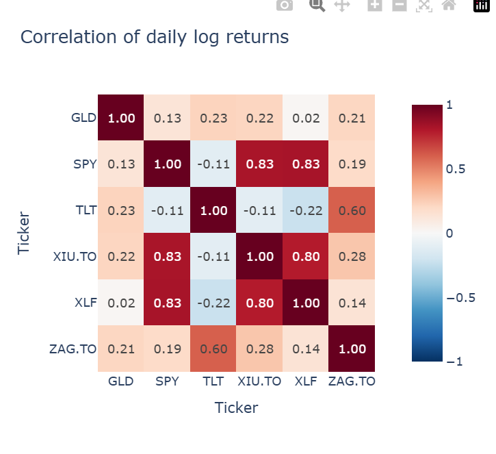
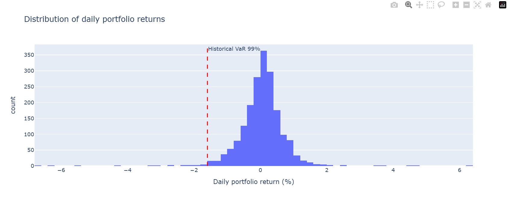
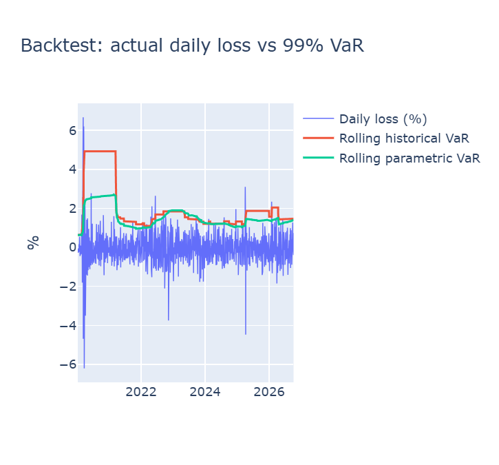
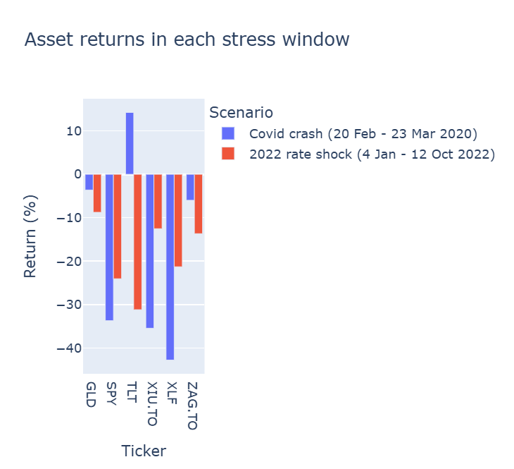
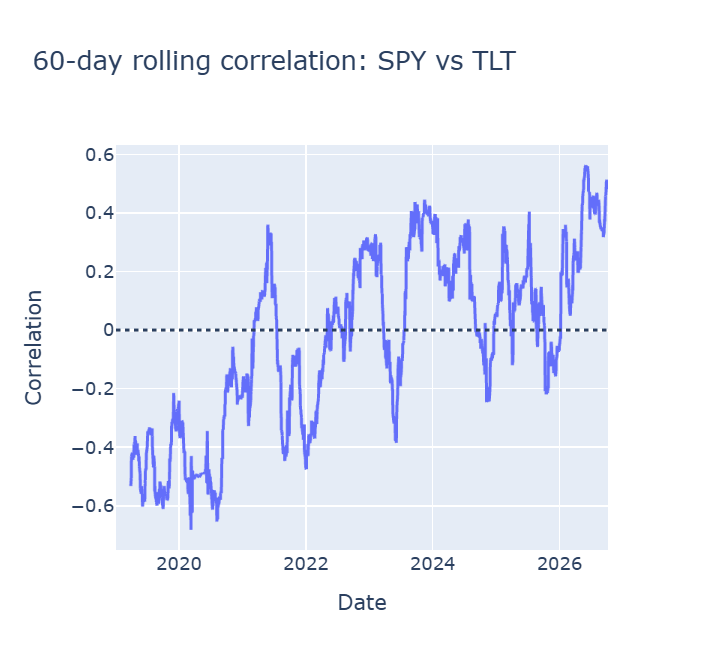

# Value at Risk and Stress Testing of a US/Canadian ETF Portfolio

A Python analysis of how much an equal-weight, six-ETF portfolio could lose on a bad day, and whether diversification held up in real crises (March 2020 and 2022).

**Business question:** a portfolio manager must decide whether to shrink total exposure or change the mix. How much could the portfolio lose in one day, and did the stock-bond hedge protect it when markets broke?

**Portfolio:** SPY and XLF (US equities), XIU.TO (Canadian equities), TLT (long US Treasuries), ZAG.TO (Canadian bonds) and GLD (gold). The $10M size and $250k VaR limit are illustrative assumptions.

## Key findings

- **One-day risk is modest.** Historical 99% VaR is 1.60% of the portfolio ($159,501 on $10M). Parametric VaR is close at 1.54%. The portfolio's annualized volatility is 10.8%, against about 17% for the average single asset, which is the diversification benefit.
- **The tails are fatter than a normal curve.** Expected Shortfall (the average loss on the worst 1% of days) is 2.88%, or 1.8 times VaR. A normal distribution would give about 1.15 times.
- **The three equity funds move together.** SPY, XIU.TO and XLF have pairwise correlations of 0.80 to 0.83, so holding all three adds little diversification.
- **Bonds hedged the 2020 crash but not 2022.** In the Covid window the equity funds lost 34% to 43% while TLT gained 14%, and the portfolio fell 19.4% (about $1.94M). In 2022 all six assets lost money, TLT fell 31%, and the portfolio fell 18.3% (about $1.83M).
- **The hedge relationship is not stable.** The 60-day SPY-TLT correlation was around -0.5 in 2019 and 2020 and has mostly been positive since 2022.
- **VaR lags.** Rolling VaR sat near 0.7% just before March 2020, when daily losses reached about 6%. After the crash it jumped to about 4.9% (historical) and stayed there for roughly a year, until the crash days left the 252-day window.
- **Backtest breaches:** **TODO: replace with the counts printed by the backtest cell.** Historical: __ breaches, parametric: __ breaches, out of 1,659 test days. A perfect 99% VaR would give about 17 each.

## Charts











## Method

1. Download daily adjusted close prices from 1 January 2019 (Yahoo Finance via `yfinance`) and keep dates when all six markets traded.
2. Compute daily log returns, then the correlation matrix and annualized volatility.
3. Build an equal-weight portfolio. Weights are applied to simple returns, since log returns add across time but not across assets.
4. Compute 99% one-day VaR two ways (historical percentile and parametric normal) and Expected Shortfall, in percent and dollars.
5. Backtest with a rolling 252-day window. Each day's VaR uses only earlier days, and a breach is a loss larger than that day's VaR.
6. Replay two crises on the portfolio: 20 Feb to 23 Mar 2020 and 4 Jan to 12 Oct 2022 (approximate peak to low for SPY). Track the SPY-TLT correlation inside each window.

## Run it

```bash
git clone https://github.com/<your-username>/<repo-name>.git
cd <repo-name>
pip install -r requirements.txt
jupyter notebook var_stress_test.ipynb
```

Prices are downloaded when the notebook runs. The results and charts above were generated in October 2026, so re-running later extends the sample and shifts the numbers slightly.

## Assumptions and limitations

- The $10M portfolio, $250k limit and equal weights are assumptions, not real holdings.
- XIU.TO and ZAG.TO are priced in CAD and the other four in USD. Returns are not converted to a single currency.
- Stress-window returns assume the portfolio is rebalanced to equal weights every day.
- Stress losses build up over weeks or months, so they are not directly comparable with a one-day VaR.
- The sample (2019 to 2026) has one crash and one rate shock and does not include 2008.
- Parametric VaR assumes normal returns. Both VaR methods assume volatility is stable within the window.

## Possible extensions

- A GARCH model so volatility can change over time
- Converting all assets to CAD with USD/CAD
- Risk contribution by asset, and reweighting with constraints

## Tools

Python, pandas, NumPy, Plotly, yfinance
